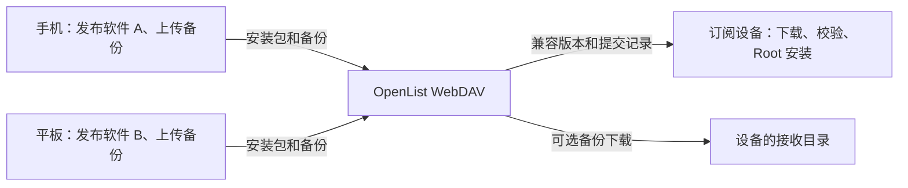

# Android 多设备应用升级与备份同步：可行性评估

设计评估日期：2026-11-20。本文件记录 Kotlin 原生方案的设计依据，参考 Android、OpenList 的官方文档及公开源码；当前实现、使用方式及验证范围见 README.md。

## 1. 结论与需求边界

**项目可行，适合实现为一个原生 Android 客户端，以 OpenList WebDAV 为文件交换中心。** 按参与自动安装的设备均可授予 Root、备份位于共享存储目录来设计，可以实现提取安装包、后台上传下载、覆盖安装，以及远端校验后清理本地备份。

主要工程难点是安装包跨设备兼容、文件完整性、多端并发和 Android 后台运行。Root 能解决安装权限问题，不能使不兼容的安装包自动兼容，也不能代替同步协议。

本次确认的需求：

- 多台 Android 手机和平板参与；每台设备可配置不同的软件和备份目录。
- 某设备指定软件更新后，检测并提取**该设备当前已安装的版本**，保存到指定本地导出目录，再上传到配置的 OpenList 路径。
- 其他订阅设备检查远端版本，下载兼容的安装包并安装。
- 定时扫描软件自行生成备份的共享存储目录，上传到指定 OpenList 路径。
- 采用 SHA-256 判断内容重复，远端已有相同内容时跳过文件内容上传。
- 无论首次上传还是命中重复，均在确认远端完整可读、校验通过后删除对应的本地备份文件。

范围解释：

- “最新版本”是订阅发布源已经发布的最新兼容版本；本项目不负责从应用商店查询和下载尚未在任何发布端安装的版本。
- 备份文件由原软件生成，本项目负责收集、归档与可选下载；原软件的自动备份和自动恢复需要其自身提供接口。
- 本地清理默认针对备份源文件及任务临时文件。APK 导出目录使用单独的保留策略；删除导出的 APK 不会卸载软件。
- 本地删除是归档完成后的清理操作，不能作为向远端传播删除的信号。后续扫描发现本地不存在该文件，远端仍然保留。

## 2. 各项功能的可行性

| 功能 | 评估 | 必要条件或限制 |
| --- | --- | --- |
| 监测指定软件安装和更新 | 可行 | 软件包变更事件加周期扫描兜底；按包名配置规则 |
| 提取已安装 APK | 可行 | 读取基础 APK 和已安装 split APK；提取前后确认版本未变化 |
| 上传到 OpenList 指定路径 | 可行 | WebDAV 账号具备读取、上传、建目录及实际流程所需权限；挂载存储支持写入 |
| 其他设备下载并自动安装 | 有 Root 时可行 | 使用系统安装会话；检查签名、版本、系统版本与设备配置 |
| 定时扫描共享存储备份目录 | 可行 | 获得目录访问权限；只收集已完成写入的文件 |
| SHA-256 去重 | 可行 | 客户端计算 SHA-256，并维护远端哈希清单；不能普遍依赖 ETag |
| 校验后删除本地备份 | 可行，需严格顺序 | 必须校验远端实际内容并确认本地待删文件未变化 |
| 每台设备配置不同任务 | 可行 | 软件规则、文件规则、发布源与订阅角色独立配置 |
| 严格固定时刻执行 | 无法普遍保证 | 关机、离线、休眠、厂商后台策略和 Root 授权状态都会影响执行 |
| 多端同时发现同一内容也绝不重复传输 | 有额外条件 | 需验证 WebDAV 锁的适用范围，或增加持久化协调服务 |

## 3. 推荐架构

第一版采用 **Android 客户端 + OpenList**。文件内容通过 WebDAV 传输；客户端保存本地任务数据库和远端不可变记录，无须一开始修改 OpenList。



客户端内部建议包含：规则配置、应用版本检测、APK 导出、备份收集、SHA-256 去重、WebDAV 传输、远端提交记录、Root 安装、任务调度与失败日志。

技术选型：Kotlin、Jetpack Compose + **Miuix UI**、Room、协程、OkHttp/WebDAV XML 解析、WorkManager，以及成熟的 Root 调用库。Miuix 为用户于 2026-11-20 指定的界面库，作为本项目的主要视觉和交互组件体系。安装通过 `pm` 安装会话或相应系统安装接口完成，记录结果并重新读取已安装版本确认成功。Root 命令参数必须安全传递，不直接拼接远端提供的文件名执行 shell。

如后续要求严格的并发去重、统一审批、远端保留策略或大规模索引，可在 OpenList 同机增加一个轻量服务，保存持久化哈希索引、上传租约和发布记录。文件仍走 OpenList WebDAV。协调服务需要用租约、过期处理和提交状态管理故障；仅有一张唯一索引表不能保证故障恢复期间绝无重复网络字节。

### 3.1 Miuix 接入与页面方案

使用 [compose-miuix-ui/miuix](https://github.com/compose-miuix-ui/miuix)。已核对发布版 **0.9.4**，并确认下面的 Android 依赖已发布到 Maven Central。工程已接入基础组件、设置与图标模块；下面为接入配置参考，其中独立导航运行库可按后续页面需求选择。

```kotlin
// Android 应用模块 build.gradle.kts；仓库配置包含 mavenCentral()
dependencies {
    val miuixVersion = "0.9.4"
    implementation("top.yukonga.miuix.kmp:miuix-ui-android:$miuixVersion")
    implementation("top.yukonga.miuix.kmp:miuix-preference-android:$miuixVersion")
    implementation("top.yukonga.miuix.kmp:miuix-icons-android:$miuixVersion")
    // 可选的独立导航运行库；首版页面状态使用 Compose 管理。
    // implementation("top.yukonga.miuix.kmp:miuix-nav-android:$miuixVersion")
}
```

固定所有 Miuix 模块为同一发布版本，按该版本文档接入；上游声明 API 仍处于实验阶段，因此更新依赖时单独验证编译与交互。Android 项目使用上面的 `-android` 制品；未来改成 Kotlin Multiplatform 工程时，再采用官方 `commonMain` 依赖方式。

Miuix 0.9.4 基础模块最低要求 `minSdk = 24`，即 Android 7.0。`miuix-blur` 单独要求 API 33；首版只接入上述基础、设置和图标模块。上游 0.9.4 使用 Kotlin 2.4.20、Compose Multiplatform 1.12.0；当前工程采用 Kotlin 2.4.21、AGP 9.4.1 和 Gradle 9.7.1，已经通过调试 APK 构建。

应用根节点统一使用 `MiuixTheme`，通过 `ThemeController` 提供跟随系统、浅色和深色模式；动态取色作为可选设置。列表、按钮、输入框、开关、对话框和进度显示统一使用 Miuix 组件与主题颜色。

| 页面 | 核心内容 | Miuix 组件选型 |
| --- | --- | --- |
| 概览 | 最近同步结果、正在执行的任务、待处理错误、手动同步入口 | `Scaffold`、`TopAppBar`、`Card`、按钮和进度组件 |
| 软件 | 本机软件规则、已安装与已发布版本、发布/订阅角色、规则详情 | 卡片列表、输入组件、`SwitchPreference`、对话框 |
| 备份 | 目录规则、已归档数量、去重结果、本地清理状态、规则详情 | 卡片列表、设置组件、进度组件 |
| 设置 | OpenList 连接、设备名称、Root 授权状态、网络与周期策略、主题 | `miuix-preference`、输入组件、对话框 |
| 任务详情 | 上传、校验、安装或清理的状态，以及失败原因与重试入口 | `TopAppBar`、信息卡片、按钮 |

手机窄窗口使用 `NavigationBar`，主入口为“概览、软件、备份、设置”；宽窗口切换 `NavigationRail`，软件和备份页面采用左侧列表、右侧详情。布局根据可用窗口宽度适配，覆盖平板分屏、横屏与字体缩放，页面选择和未提交表单在布局切换时保留。

界面状态使用“等待备份完成、上传中、校验中、已归档、待清理、已完成、需处理”等用户可理解的文案。清理开关遵循已确认的“远端校验后删除本地”规则，界面操作不能跳过远端校验；备份文件下载与原软件恢复操作分别呈现。设置页保存凭据但不回显明文密码，失败提示不包含认证信息。

Miuix 使用 Apache-2.0 许可证。发布客户端时保留依赖所要求的许可证、版权及适用声明，在关于页面提供开源依赖信息。

### 3.2 Flutter、Rust 与 Kotlin 的适用性比较

用户要求比较 Flutter 与 Rust。Flutter 是使用 Dart 的应用 UI 框架，Rust 是系统编程语言，二者承担的角色不同。对本项目的结论是：**主应用继续采用 Kotlin + Compose + Miuix；首版同步逻辑也用 Kotlin。Rust 可以作为后续可选的同步或文件处理模块，Flutter 只有在重新选择 UI 体系时才更有价值。**

| 评价维度 | Flutter / Dart | Rust | Kotlin / Compose |
| --- | --- | --- | --- |
| 完整 Android 应用开发 | UI、路由和应用开发生态成熟；系统功能通过插件或平台代码接入 | 能编译到 Android，但单靠语言本身不提供完整 Android UI 与应用组件体系 | 直接使用 Android 应用组件和系统 API |
| 使用已指定的 Miuix 仓库 | 无法直接使用 Compose 组件；需嵌入 Kotlin 页面或另写 Flutter 界面 | 无法直接渲染 Compose 组件；仍需 Kotlin UI 层 | 直接使用，符合已确定的选型 |
| 软件更新事件、APK 提取和分包安装 | 通过插件、平台通道或 Kotlin/Java 实现，验证插件覆盖范围 | 可调用 Root 命令，也可经 JNI 接入系统 API；生命周期等需要 Android 集成层 | 使用 PackageManager、广播、安装会话及 Root 调用库 |
| 周期调度、开机恢复和后台任务 | 可通过 WorkManager 插件和后台 Dart 执行，但仍受 Android 规则约束 | 需集成 Android 调度或单独部署 Root 守护；语言不提供后台存活保证 | WorkManager、服务与开机恢复可在同一技术栈内实现 |
| WebDAV、SHA-256、流式上传下载 | 可以实现，使用流式 I/O 避免大文件整体加载 | 可以实现，适合明确需要的文件处理与可复用内核 | 可以实现，现有能力足够支持首版 |
| 手机和平板适配 | 成熟；需要自行实现响应式页面 | 取决于选择的 UI 层 | Compose 与 Miuix 可按窗口宽度适配 |
| 首版集成和维护成本 | Dart 与 Android 平台层协作；嵌入 Miuix 时还要维护两套 UI 集成 | Rust 加 Android UI/系统层，增加 NDK、ABI、JNI 与跨语言调试 | 主要维持 Kotlin 与 Android Gradle 工程 |
| 后续跨平台价值 | 在计划独立开发其他平台客户端时有优势 | 同步协议、校验和传输内核可供多种宿主复用 | Android 集成最直接；Compose Multiplatform 可评估复用部分 UI |

**若只比较“用哪个方案开发完整 App”，Flutter 比纯 Rust 更合适。** 但若保留用户指定的 Miuix，Flutter 需要额外嵌入原生 Compose 页面，导航、状态、生命周期与渲染也需要协调，因此会增加当前项目的复杂度。Rust + Kotlin 可以保留 Miuix，但其主要优势是共享内核，而非替代 Kotlin UI。

Flutter 的 Platform Views 能托管 Android 原生 View，再由 ComposeView 承载 Compose UI，因此技术上可以集成 Miuix；这不是直接添加一个 Flutter 组件依赖。对主要界面都要求使用 Miuix 的新项目，没有必要为这种集成引入另一套主 UI 框架。名称或风格类似的 Flutter 库也不能视为用户指定仓库的直接替代。

Rust 可通过 JNI 或 C ABI 被 Kotlin/Dart 调用，也可构建单独的 Android Root 命令行进程。引入时需明确线程、取消、回调、内存所有权、错误传递与进程恢复边界，并为目标 CPU ABI 构建产物。能执行 Root 命令与获得系统权限是两回事，任何技术栈都需设备实际授予 Root。

性能判断应依据实际测量：本项目大多时间花在磁盘读取、网络上传下载和远端回读校验。Kotlin 和 Dart 也能进行流式处理，成熟的 JVM 加密实现也可能有良好优化；换成 Rust 不自动提高传输速度或后台可靠性。若以后增加大量压缩、加密或复杂文件处理，并测得 CPU/内存瓶颈，再比较 Rust 的实际收益。

本地文件是否能安全删除取决于写入完成判断、远端校验、提交协议和故障恢复，语言的内存安全不能替代这些业务条件。跨平台框架也不会让 Android APK 安装和 Root 功能在 iOS 上获得同等支持；Android 手机和平板本身属于同一平台，当前没有强烈的跨操作系统需求。

首版建议分层但保持单一主语言：

```text
Kotlin + Compose + Miuix：界面、设置、任务状态
Kotlin：Android 权限、包管理、安装、调度与 Root 集成
Kotlin：WebDAV、SHA-256、提交协议、任务数据库与恢复
后续可选 Rust：经过验证需要的文件处理或跨平台同步内核
```

以上是工程适配性评估，未做 Flutter、Rust 与 Kotlin 的同条件性能基准。用户已确定 Kotlin 原生方案，当前工程没有引入 Flutter 或 Rust。

### 3.3 首个开发版状态

工程已开始实现单 APK 发布/订阅、Miuix 配置页面、共享目录备份、WebDAV 回读校验、SHA-256 去重、来源记录提交、本地清理和 WorkManager 调度。Room 保存规则、文件观察状态与任务日志，WebDAV 密码由 Android Keystore 加密。

当前是 0.1.0 开发版。这里的架构与验收条件包含后续目标，不等于全部已经通过真机验收。分包安装、独立 Root 守护、服务端并发协调、备份下载/恢复和远端历史回收尚未实现，实际边界以 README.md 为准。

## 4. 软件升级流程与兼容性

### 4.1 推荐流程

1. 软件包变更事件触发检查，周期扫描补偿漏报。
2. 读取包名、`longVersionCode`、版本名、签名信息、基础 APK 路径和 split APK 路径。
3. 把基础包及所需分包复制到指定导出目录的暂存区，记录各文件大小和 SHA-256；再次核对源版本，发生更新则重新提取。
4. 上传到版本专属路径，校验全部文件；最后发布完整的版本提交记录。
5. 接收设备读取已提交记录，按软件发布源、渠道、签名和设备配置选择兼容版本。
6. 下载到安装暂存区，核对实际 APK 内容、包名、签名和哈希。
7. 通过 Root 创建安装会话，把基础包及分包一并提交；读取返回结果，再确认已安装版本。
8. 安装失败保留状态与日志，延迟重试或等待处理；不自动卸载现有软件。

### 4.2 不能把所有软件都当成单个 APK

Android 的 `ApplicationInfo.sourceDir` 指向基础 APK，`splitSourceDirs` 指向已安装分包。应用商店安装的软件可能包含 CPU 架构、屏幕密度、语言和动态功能分包。只导出 `base.apk` 可能无法安装，或安装后缺少功能。

**从手机提取完整的已安装分包，也不意味着平板一定能使用。** 源设备可能没有平板需要的其他配置分包。目标不兼容时必须等待兼容设备发布对应包组，或由用户提供同版本官方通用 APK；不能从已有分包凭空生成缺失内容。

第一版优先支持单 APK、同一渠道、同签名的软件，再验证真实目标软件的分包情况。第二阶段增加完整分包安装和设备兼容匹配。自定义 ZIP 可用于保存包组，但不能简单把任意 ZIP 改名为 `.apks` 后假定它就是标准 APKS 文件。

APK 不包含应用全部运行数据、OBB/额外资源或在线下载的全部内容；这些需要另行配置资源或备份规则。

### 4.3 版本选择与冲突规则

- 每个软件分别指定发布设备和订阅设备，手机可发布 A、平板可发布 B。第一版建议每个软件、渠道和兼容组只有一个有效发布源。
- “最新”按同一发布轨道内的 `longVersionCode` 判断，不按上传时间或文件修改时间。
- 高版本设备不会因为低版本设备晚上传而被降级。
- 相同版本号、不同内容的包组分别保存；可能是设备分包差异或渠道差异，不能自动互相覆盖。
- 签名必须相同，或具有系统接受的合法签名轮换关系。Root 不应绕过签名保护，也不应通过先卸载来解决签名冲突。
- 下载升级后触发的本机软件更新事件，先根据包组身份和任务记录判断是否已经归档，避免重复发布。
- 第一版限定主用户中的普通第三方应用。系统应用、工作资料、多用户空间和同步客户端自身更新另行评估。

## 5. 备份上传、去重与本地清理

### 5.1 正确的完成顺序

```text
发现文件 → 确认写入完成 → 创建一致快照 → 计算 SHA-256
  → 查询远端已提交的同哈希对象
    → 已存在：校验远端对象
    → 未存在：上传暂存对象，校验并完成发布
  → 写入并确认本次来源记录
  → 确认本地待删文件仍对应原快照
  → 删除本地备份并记录完成状态
```

**只有远端数据与来源记录都可读取、校验通过，才允许清理本地。** 上传失败、远端校验失败、提交记录不完整、本地源文件变化或权限异常时，保留本地文件并等待重试。仅有 HTTP 成功响应、同文件名、同大小或客户端自行生成的哈希清单，都不足以证明远端内容完整。

相同 SHA-256、不同文件名或不同设备来源，文件内容只保存一份，但新增来源记录，保留原文件名、设备、规则、时间和远端位置。重复时“不上传”指跳过文件内容上传，仍可能写入小体积元数据。

### 5.2 OpenList 的 SHA 能力必须探测

OpenList 当前公开源码实现了 WebDAV `checksums` 扩展属性，返回挂载驱动所提供的哈希集合。具体存储不一定提供 SHA-256，返回的算法也不统一。WebDAV ETag 也不能一般地视为文件 SHA-256。

建议：

- 客户端统一计算 SHA-256，并保存受控的哈希与来源记录，用于定位候选重复对象。
- 若底层存储能提供可信的、实际文件内容的 SHA-256，可直接比对；部署时验证其语义。
- 没有可信 SHA-256 时，上传完成后重新读取远端文件流，计算 SHA-256；只命中客户端清单时也按此原则验证。
- 远端清单是检索工具，不能作为唯一的删除依据。未来可以用受控不可变存储与可信服务端校验减少回读成本。

回读有实际开销：1 GB 新文件可能需要约 1 GB 上行和 1 GB 校验下行。重复文件若也需要回读，虽然不再上传，仍会消耗下行流量。这是纯 WebDAV、缺乏可信服务端哈希时的成本。

### 5.3 避免读取或删除还在写的备份

最好由原软件采用“临时文件写完后重命名为最终文件”的方式，或提供备份完成事件。客户端只收集最终文件，排除 `.tmp`、`.part` 等临时文件。

若没有完成信号，可设置稳定等待，例如大小和修改时间连续 60～120 秒不变后才创建快照；**稳定等待只是启发式判断，不能证明软件以后不会继续写入。** 对无法可靠判断完成的文件，应保留源文件或使用更长等待，并在真实软件上验证。

上传期间使用任务快照。清理前检查源文件身份与内容是否仍对应快照；如原路径被覆盖、重新生成或文件发生变化，不能删除新的文件。队列接管或同卷重命名应只用于已确认生产者不再写入的文件，避免把活跃文件移走。

扫描和删除范围限定在明确配置的备份目录，排除安装包暂存、下载接收目录、符号链接越界路径及其他规则不允许的文件。备份接收目录与上传源目录分开，避免刚下载又上传、清理的循环。

### 5.4 删除后的保障边界

远端校验说明文件在校验时完整可读取，并不等于云盘永久保存或具备灾难恢复能力。按照本需求，清理本地后远端可能成为唯一副本，因此远端保留与删除应独立配置；如需要抵御云盘故障，应另设第二份远端备份或保留周期。

## 6. 远端目录与多设备并发

推荐优先保留用户指定的实际应用和备份路径，在同一目标目录内去重：

```text
指定软件目录/
  releases/<版本号>/<包组ID>/
    base.apk
    splits/...
    release.json
  commits/<设备ID>-<唯一记录ID>.json

指定备份目录/
  objects/<SHA256前两位>/<完整SHA256>/<首次归档文件名>
  records/<设备ID>/<唯一记录ID>.json
  staging/<设备ID>/<任务ID>/...
```

`release.json` 包含包名、版本、签名、配置、完整文件列表及哈希。包组 ID 由规范化文件清单计算，不能只使用基础 APK 的哈希识别整个版本包组。提交记录只在所有文件成功校验后发布；接收端不读取暂存区，也不依赖一个多端共同覆盖的 `latest.apk` 或 `latest.json`。

备份来源记录指向实际对象，原始文件名变化不会造成内容重复。若要求跨不同目标目录也只存一份内容，可以改用共享 `objects` 仓库和逻辑目录引用；此时每个目录里不一定都有独立实体文件，不能同时承诺全局只存一份又在所有路径保存实体副本。第一版建议去重范围为相同配置目标目录。

并发处理：

- 多端分别写入唯一记录，避免共用索引整文件覆盖；客户端从已提交记录构建本地索引。
- 暂存上传与最终发布分离；若底层 MOVE/重命名能力已验证，可以利用它完成发布，但不把跨存储 MOVE 当成原子事务。
- 同一 OpenList 实例的 WebDAV 锁可作为经过验证的互斥手段。当前公开源码使用内存锁，重启或多实例部署时不能视为持久化分布式锁。
- 简单的“查不存在，再上传”存在竞态，两台设备可能同时开始上传。基础版采用单发布源、错峰扫描和幂等提交，避免记录丢失，但不能承诺所有故障情况下都没有冗余传输。
- 需要严格协调时，增加持久化服务管理上传租约、重复对象与提交状态。仍然以真实远端校验作为本地删除条件。

暂存对象、提交记录及对象引用需要一致的保留策略。第一版不自动清理远端历史文件；以后引入远端回收时，必须确认没有有效来源记录引用对象，并避免删除正在上传或校验的对象。

## 7. 后台执行、配置与故障恢复

WorkManager 周期任务最短间隔是 15 分钟，系统可以因约束、休眠和优化而延迟执行。建议默认每 30 分钟补偿扫描，应用更新事件触发额外检查；默认只在 Wi-Fi 下传输大文件，可配置电量与充电条件。

针对 Root 设备，若使用 Magisk 等方案，可增加开机守护与任务唤醒，提高长时间待机后的执行可靠性。Root 授权、开机恢复、后台白名单和机型策略仍需实测。前台服务本身也不是严格定时或永久存活的保证。

每台设备独立设置：

| 软件规则 | 文件规则 |
| --- | --- |
| 包名、发布源、发布/订阅角色 | 本地源目录、目标 WebDAV 路径 |
| 本地导出目录、远端软件目录 | 文件匹配规则、是否扫描子目录 |
| 渠道、允许设备配置 | 完成信号或稳定等待时间 |
| 自动安装开关、安装时间窗口 | 扫描周期、网络和电量条件 |
| APK 保留数量 | 远端验证后清理本地开关 |

建议本地任务状态持久化为：发现、等待稳定、已快照、已算哈希、上传中、待远端校验、已提交、待本地清理、完成、待重试。进程被杀或设备重启后从状态继续；安装失败与上传失败分别处理。日志记录失败阶段和原因，支持暂停单条规则、手动重试和查看远端对象位置。

认证使用 HTTPS，凭据由 Android Keystore 保护。发布权限按软件与目录限制；接收端保留受信任签名规则。SHA-256 校验完整性，软件签名和发布源约束校验来源，两者都需要。

## 8. 实施顺序与工作量

估算以一名熟悉 Android、Root 和网络传输的开发者为前提，是规划区间，尚不是经设备验证的交付承诺。

| 阶段 | 范围 | 预计投入 |
| --- | --- | --- |
| 技术验证 | 一台手机、一台平板、实际 OpenList；测试 APK 提取安装、WebDAV 校验与写入、备份完成行为 | 3～5 个工作日 |
| 首版开发 | 单 APK、每软件单发布源、规则配置、周期调度、上传下载、SHA 去重、安全清理与日志 | 3～5 周 |
| 稳定性验收 | 断网、重启、并发、文件变化、后台运行与失败恢复 | 1～2 周 |
| 后续扩展 | 完整分包兼容、更多机型、协调服务、统一配置、远端回收 | 另计 3～6 周 |

首版约 **5～8 周**，取决于具体软件、Root 方案、设备数量与 OpenList 存储驱动。若从一开始要求跨多种设备安装商店分包、严格并发协调和完整管理能力，可先按 **8～14 周** 规划，并在技术验证后重新估算。

可先用 Root 脚本、已有 APK 管理工具和 WebDAV 工具验证两条流程，但正式版需要统一处理提交状态、来源记录和安全清理；仅拼接定时复制与删除命令，很难满足该需求的故障恢复条件。

## 9. 验收条件

1. 软件 A 在发布手机更新后，兼容平板在配置的检查周期后安装同一已发布版本；离线期间保留任务，联网后继续。
2. 手机发布 A、平板发布 B，各自的规则和目标目录独立生效。
3. 一个已归档内容以不同文件名在其他设备出现，跳过内容上传，保留新的来源记录，校验后清理该设备本地文件。
4. 同名不同内容均保留；低版本晚上传不会触发其他设备降级。
5. 断网、远端满盘、权限拒绝、文件截断、哈希不一致或提交记录写入失败时，本地文件不删除。
6. 上传期间原路径重新生成文件或内容变化，不会删除新文件，也不会把变化文件误判为已完成。
7. 设备在上传、提交或本地清理阶段重启，可恢复任务，不因重复执行丢失文件或记录。
8. 缺少分包、签名冲突、系统版本不支持时不安装，不自动卸载原软件，能够看到原因。
9. 本地清理不会删除远端归档，也不会使备份接收目录陷入上传与删除循环。
10. 同时上传、长时间休眠和服务重启的行为符合所选择的并发与调度边界；通过实际手机、平板和挂载存储验证。

## 10. 开发前尚需落实的资料

先完成上述技术验证，再决定全面开发。验证所需资料：目标软件包名及安装渠道、设备型号和 Android 版本、各端 Root 方案、OpenList 版本与挂载存储类型、实际备份目录与文件生成方式、期望周期及设备规模。

其中最影响结论的是：目标软件是否为分包安装、手机和平板是否同一兼容配置、备份是否能可靠判断完成，以及 OpenList 底层能否提供可信校验。当前评估支持开始验证，尚不能保证未经测试的任意软件和任意云盘驱动都能直接通用。

## 11. 参考依据

- [Android ApplicationInfo：sourceDir 与 splitSourceDirs](https://developer.android.com/reference/android/content/pm/ApplicationInfo)
- [Android PackageInstaller.SessionParams：安装会话与用户操作条件](https://developer.android.com/reference/android/content/pm/PackageInstaller.SessionParams)
- [Android WorkManager：周期任务间隔和执行限制](https://developer.android.com/develop/background-work/background-tasks/persistent/getting-started/define-work)
- [Android 应用签名](https://developer.android.com/studio/publish/app-signing)
- [OpenList WebDAV 文档：连接路径与权限](https://doc.oplist.org/guide/advanced/webdav)
- [OpenList WebDAV 属性源码：ETag 与 checksums](https://github.com/OpenListTeam/OpenList/blob/main/server/webdav/prop.go)
- [OpenList WebDAV 初始化源码：内存锁](https://github.com/OpenListTeam/OpenList/blob/main/server/webdav.go)
- [OpenList WebDAV 请求处理源码](https://github.com/OpenListTeam/OpenList/blob/main/server/webdav/webdav.go)
- [Miuix 0.9.4 发布说明](https://github.com/compose-miuix-ui/miuix/releases/tag/v0.9.4)
- [Miuix 0.9.4 接入文档：Android 与 Multiplatform 依赖](https://github.com/compose-miuix-ui/miuix/blob/v0.9.4/docs/guide/getting-started.md)
- [Miuix 0.9.4 主题文档](https://github.com/compose-miuix-ui/miuix/blob/v0.9.4/docs/guide/theme.md)
- [Flutter 平台通道：接入 Kotlin/Java 系统能力](https://docs.flutter.dev/platform-integration/platform-channels)
- [Flutter 后台执行与 WorkManager](https://docs.flutter.dev/packages-and-plugins/background-processes)
- [Flutter Platform Views：托管 Android 原生 View](https://docs.flutter.dev/platform-integration/android/platform-views)
- [Flutter FFI：调用原生代码](https://docs.flutter.dev/platform-integration/bind-native-code)
- [Rust Android 目标支持与 NDK 构建](https://doc.rust-lang.org/rustc/platform-support/android.html)

以上 OpenList 源码依据为评估当日的公开 main 分支；实际部署版本和具体挂载驱动的行为以验证结果为准。
